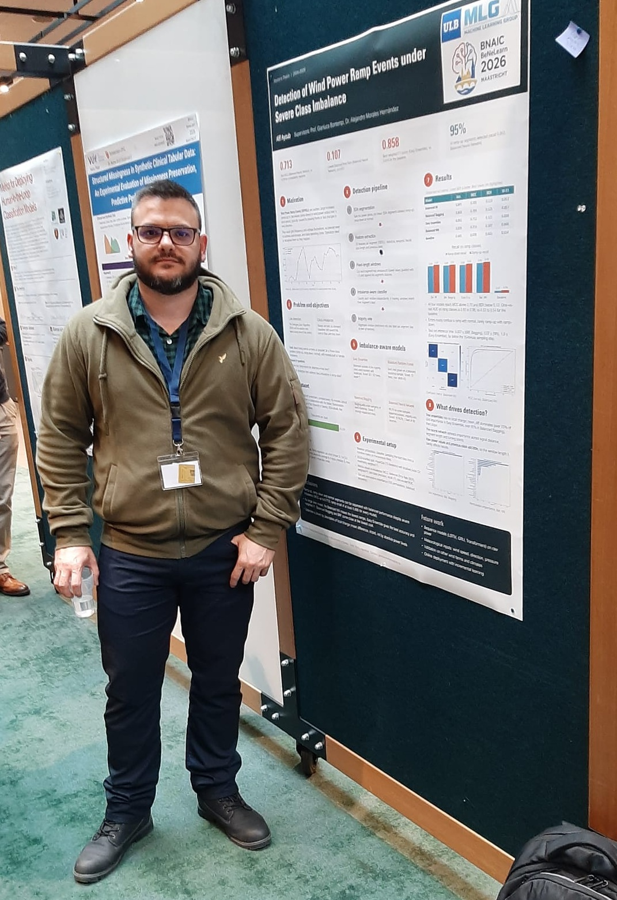

Wind power ramp events are sudden, large changes in generated power that threaten grid stability and raise maintenance costs. Classical detectors label a ramp only after it has ended and standard approaches tend to favor the majority class due to class imbalance. This thesis reformulates detection as a three-class problem (ramp-up, ramp-down, normal) solved on short subsequences, so a decision is available while the event unfolds, and compares four imbalance-aware learners
with a Markovian baseline. On 80 days of 15-minute wind farm data, all four reach Matthews Correlation Coefficient above 0.70 and Balanced Error Rate below 0.13, against 0.038 and 0.653 for the baseline. Local variation features carry nearly all the signal, and raw power values are nearly irrelevant.

[View Poster](..\files\Ramp_Events_Poster_A0.pdf)

[View Abstract](https://openreview.net/pdf/b0a95f7d91df0e3e3ca3d1d54c8fc93f6afca436.pdf)

