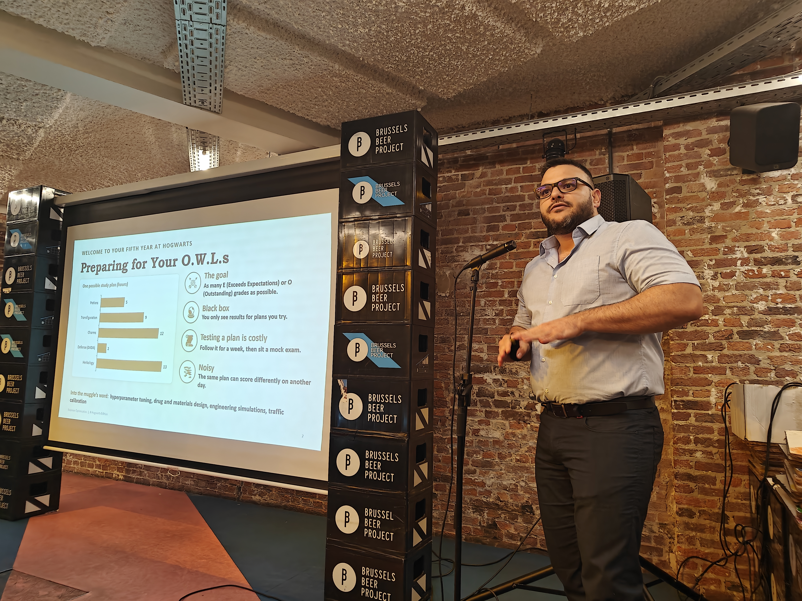
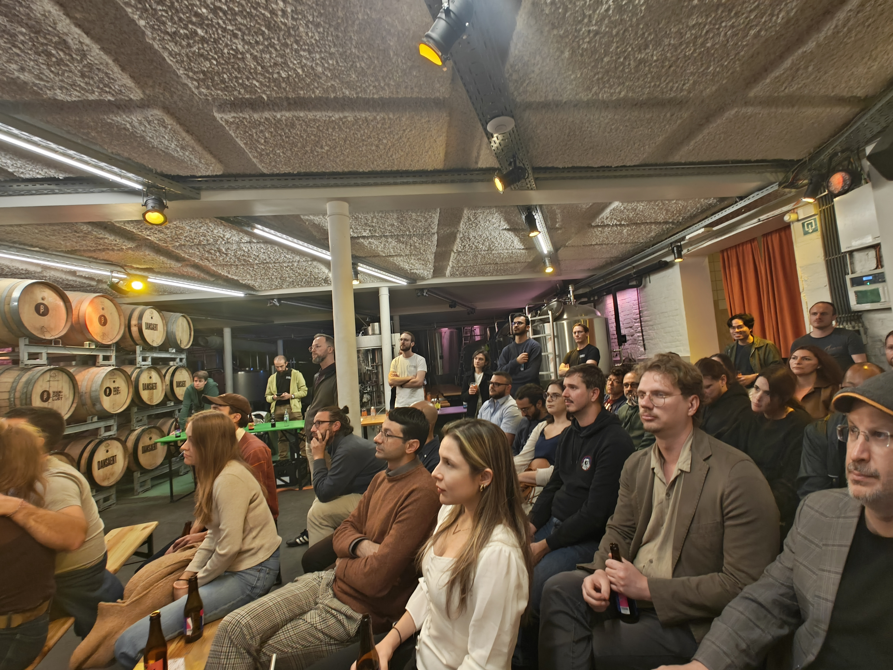
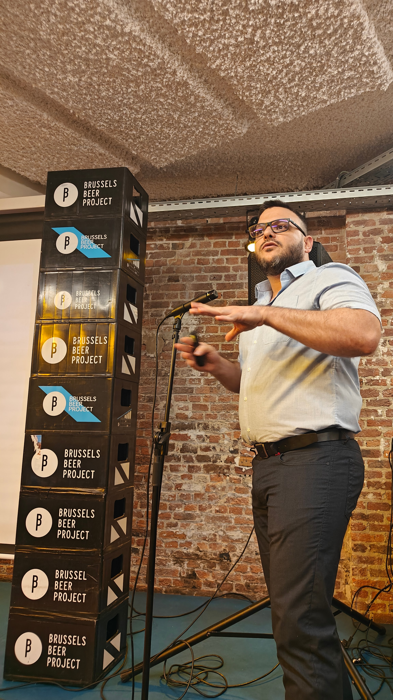

Welcome to your fifth year at Hogwarts! Imagine you are preparing for your O.W.L.s exams (Ordinary Wizarding Levels) with limited time to study. You must decide how to distribute your time across different subjects to maximize your chances of achieving a good grade. Rather than trying every possible study plan, you could use the results of previous attempts to make informed decisions about where to invest your time. This simple scenario illustrates the fundamental idea behind **Bayesian Optimization** (BO), a method for finding optimal solutions to complex problems when evaluating each possible choice is costly or time-consuming. In this presentation, I will introduce the basic principles of Bayesian Optimization and explore how it balances learning about uncertain outcomes with selecting promising options. We will highlight two key benefits of BO: its ability to identify effective solutions with relatively few evaluations and its ability to guide decision-making in expensive optimization problems, where testing every possibility is impractical.

